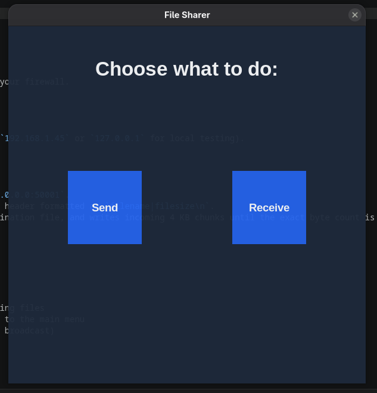
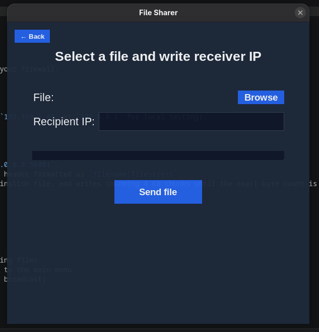
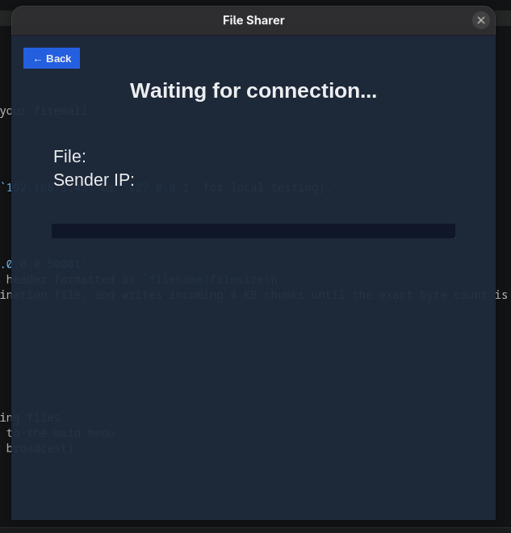

# File Sharer

A lightweight desktop peer-to-peer file transfer utility built with Python, Tkinter, and raw TCP sockets. Allows sending files directly between devices over a local network without third-party servers or size limits.

## Features

- **Direct P2P Transfer:** Uses raw TCP sockets (`socket`) for fast, direct file transfers over LAN or localhost.
- **Chunked Streaming:** Reads and sends files in 4 KB chunks, keeping memory usage minimal regardless of file size.
- **Real-Time Progress:** Live progress bars and transfer status updates for both sender and receiver.
- **Responsive UI:** Multi-threaded network handling (`threading`) ensures the Tkinter GUI never freezes during file transfers.
- **Zero External Dependencies:** Built entirely with the Python Standard Library.

## Requirements

- Python 3.8+
- `tkinter` (usually included with Python; on Linux, install via `sudo dnf install python3-tkinter` or `sudo apt install python3-tk` if missing)

## Installation & Usage

1. **Clone the repository:**
   ```bash
   git clone https://github.com/trid147/python-portfolio
   cd python-portfolio/file-sharer
   ```

2. **Run the application on both devices:**
   ```bash
   python3 main.py
   ```

3. **Receive a file:**
   - Click **Receive** on the target machine.
   - Make sure TCP port `50001` is allowed through your firewall.

4. **Send a file:**
   - Click **Send** on the sender machine.
   - Click **Browse** to select a file.
   - Enter the recipient's local IP address (e.g., `192.168.1.45` or `127.0.0.1` for local testing).
   - Click **Send file**.

## How It Works

1. The receiver starts a TCP server listening on `0.0.0.0:50001`.
2. Upon connection, the sender transmits a metadata header formatted as `filename|filesize\n`.
3. The receiver parses the header, creates the destination file, and writes incoming 4 KB chunks until the exact byte count is reached.

## GUI







## Future Improvements

- [ ] Custom destination folder selection for incoming files
- [ ] Graceful socket shutdown when navigating back to the main menu
- [ ] Automatic local network device discovery (UDP broadcast)
